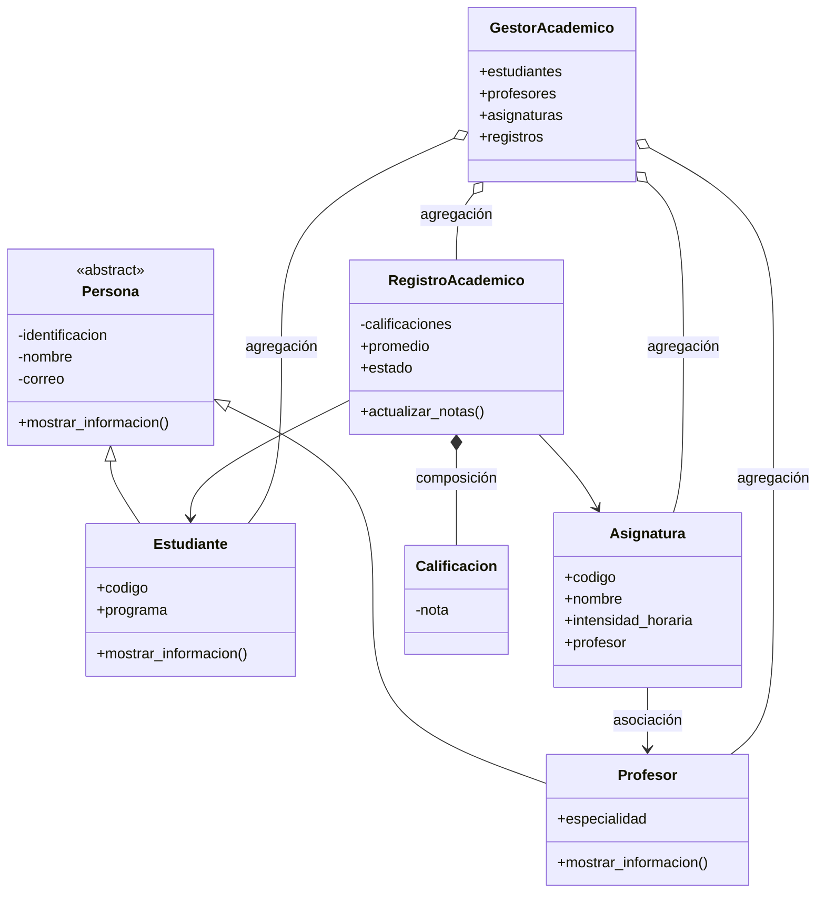

# EDUCONTROL 2.0
## INFORME TÉCNICO
### Sistema de Gestión Académica

**Lenguaje:** Python  
**Paradigma:** Programación Orientada a Objetos  
**Tipo de aplicación:** Aplicación de escritorio  
**Versión documentada:** EDUCONTROL_v5_dashboard  
**Autor:** Martin Castro

---

# 1. Análisis del problema

La administración manual de estudiantes, profesores, asignaturas y calificaciones puede dificultar el seguimiento del rendimiento académico. También requiere realizar cálculos repetitivos para obtener promedios, identificar estudiantes que necesitan atención y comparar resultados entre asignaturas.

EDUCONTROL 2.0 propone una aplicación de escritorio que centraliza estas operaciones mediante una interfaz gráfica organizada. Su propósito es facilitar el registro, la consulta y la administración de información académica, proporcionando herramientas para visualizar el rendimiento de los estudiantes.

El público objetivo son docentes o personal académico que necesitan registrar y consultar información académica de un grupo de estudiantes.

## 1.1. Objetivo general

Desarrollar un sistema de escritorio que permita administrar información académica y consultar el rendimiento de los estudiantes mediante el registro de calificaciones, el cálculo automático de promedios y la presentación de indicadores y reportes.

## 1.2. Objetivos específicos

- Diseñar clases que representen las principales entidades de un entorno académico.
- Aplicar los principios de encapsulamiento, herencia, polimorfismo y abstracción.
- Establecer relaciones entre los objetos que conforman el sistema.
- Desarrollar una interfaz gráfica que permita interactuar con las funcionalidades de la aplicación.
- Implementar operaciones para administrar estudiantes, profesores y asignaturas.
- Incorporar el registro y la validación de calificaciones.
- Generar estadísticas que faciliten el análisis del rendimiento académico.
- Realizar pruebas para verificar el funcionamiento de los componentes principales.

## 1.3. Funcionalidades principales

El sistema cuenta con las siguientes funcionalidades:

1. **Gestión de estudiantes:** permite registrar, editar, buscar y eliminar estudiantes.
2. **Gestión de profesores:** permite administrar la información de los profesores y sus especialidades.
3. **Gestión de asignaturas:** permite crear y administrar asignaturas, además de asignar un profesor responsable.
4. **Gestión de calificaciones:** permite registrar y actualizar exactamente tres calificaciones por estudiante y asignatura.
5. **Validación académica:** verifica que las notas estén dentro de la escala de 0.0 a 5.0, calcula el promedio y determina el estado académico.
6. **Dashboard:** presenta indicadores generales y gráficas relacionadas con el rendimiento académico.
7. **Reportes:** permite consultar información por asignatura, estadísticas y ranking de estudiantes.
8. **Detalle de asignaturas:** presenta información del docente, estudiantes, promedios y calificaciones correspondientes.

## 1.4. Alcance y limitaciones

La aplicación utiliza almacenamiento en memoria mediante listas y objetos de Python. No utiliza una base de datos ni archivos de persistencia; por esta razón, los cambios realizados durante una sesión se pierden al cerrar el programa.

Cuando el sistema se inicia sin información registrada, carga datos ficticios de demostración para facilitar la visualización de sus funcionalidades.

Cada registro académico contiene exactamente tres calificaciones. La versión documentada no incorpora autenticación, perfiles de usuario ni permisos por roles.

---

# 2. Diseño inicial y modelo de clases

El diseño de EDUCONTROL parte de la identificación de los elementos principales que intervienen en la administración académica.

A partir de estos elementos se definieron las clases encargadas de representar las personas, asignaturas, calificaciones y registros académicos.

Cada clase tiene una responsabilidad específica, evitando concentrar toda la lógica del sistema en un único componente.

## 2.1. Clases principales

| Clase | Responsabilidad |
|---|---|
| `Persona` | Clase abstracta que define los datos comunes de una persona: identificación, nombre y correo. |
| `Estudiante` | Hereda de Persona y agrega información como código y programa académico. |
| `Profesor` | Hereda de Persona y agrega la especialidad del profesor. |
| `Asignatura` | Representa una materia, su código, nombre, intensidad horaria y profesor opcional. |
| `Calificacion` | Representa una nota individual y valida que sea numérica y esté entre 0.0 y 5.0. |
| `RegistroAcademico` | Relaciona un estudiante con una asignatura, contiene tres objetos Calificacion y calcula promedio y estado. |
| `GestorAcademico` | Administra las colecciones y concentra las operaciones y estadísticas del sistema. |
| `VentanaPrincipal` | Coordina la interfaz gráfica y la navegación entre las diferentes vistas. |

## 2.2. Responsabilidades del diseño

La estructura se diseñó para separar los datos de las operaciones y de la presentación visual.

Los modelos representan las entidades académicas y contienen sus validaciones. El gestor coordina las operaciones del sistema, mientras que la interfaz permite que el usuario interactúe con las funcionalidades disponibles.

Esta separación facilita el mantenimiento del código y permite modificar una parte del sistema sin afectar innecesariamente las demás.

## 2.3. Diagrama de clases

El siguiente diagrama representa las principales clases y relaciones del proyecto.



---

# 3. Arquitectura del sistema

EDUCONTROL 2.0 utiliza una arquitectura modular organizada en tres capas principales: modelos, servicios e interfaz gráfica.

La estructura establece una separación de responsabilidades en la que la interfaz depende de los servicios y los servicios utilizan los modelos. Los modelos no necesitan conocer los componentes gráficos.

## 3.1. Organización por capas

| Capa | Carpeta | Responsabilidad |
|---|---|---|
| Modelos | `modelos/` | Contiene las clases que representan las entidades académicas y sus validaciones. |
| Servicios | `servicios/` | Contiene el gestor que coordina las operaciones, administra los registros y calcula estadísticas. |
| Interfaz | `interfaz/` | Contiene la ventana principal, vistas, componentes visuales, gráficas, iconos y tema. |
| Pruebas | `pruebas/` | Contiene las pruebas automatizadas del sistema. |

## 3.2. Estructura de archivos

La organización del proyecto es la siguiente:

```text
EDUCONTROL/
│
├── main.py
│
├── modelos/
│   ├── persona.py
│   ├── estudiante.py
│   ├── profesor.py
│   ├── asignatura.py
│   ├── calificacion.py
│   └── registro_academico.py
│
├── servicios/
│   └── gestor_academico.py
│
├── interfaz/
│   ├── ventana_principal.py
│   ├── vista_dashboard.py
│   ├── vista_asignaturas.py
│   ├── componentes.py
│   ├── graficas.py
│   ├── iconos.py
│   └── tema.py
│
├── pruebas/
│   ├── test_academico.py
│   ├── test_estadisticas.py
│   └── test_graficas.py
│
├── docs/
│   └── INFORME_TECNICO.md
│
├── Evidencias/
│
├── requirements.txt
└── README.md
```

## 3.3. Comunicación entre componentes

El funcionamiento general sigue este proceso:

1. El usuario realiza una acción desde un botón, formulario, buscador o tabla.
2. La vista ejecuta el callback correspondiente.
3. El callback llama al método necesario de `GestorAcademico`.
4. El gestor verifica que los datos y las relaciones sean válidos.
5. El gestor crea, actualiza o elimina los objetos correspondientes.
6. Si se presenta un dato inválido, se genera un error de validación.
7. La interfaz muestra el aviso correspondiente y actualiza la información visible.

## 3.4. Punto de entrada

El archivo `main.py` funciona como punto de entrada de la aplicación.

Desde este archivo se inicia la ventana principal, que coordina la interfaz y el gestor académico para permitir el funcionamiento de los diferentes módulos.

---

# 4. Aplicación de la Programación Orientada a Objetos

La Programación Orientada a Objetos constituye la base del desarrollo de EDUCONTROL 2.0. Las entidades académicas se representan mediante clases y objetos que interactúan para realizar las operaciones del sistema.

## 4.1. Clases y objetos

Se implementaron clases para representar los elementos principales del entorno académico.

Por ejemplo:

- Cada estudiante registrado es un objeto de la clase `Estudiante`.
- Cada profesor registrado es un objeto de la clase `Profesor`.
- Cada materia corresponde a un objeto de la clase `Asignatura`.
- Cada nota individual se representa mediante un objeto de la clase `Calificacion`.
- Cada relación entre un estudiante y una asignatura se representa mediante `RegistroAcademico`.

El `GestorAcademico` mantiene colecciones de estos objetos y coordina sus operaciones.

## 4.2. Encapsulamiento

El encapsulamiento permite proteger el estado interno de los objetos y controlar el acceso a sus atributos.

En la clase `Persona`, los atributos se almacenan como `_identificacion`, `_nombre` y `_correo`, y se consultan mediante propiedades de solo lectura.

En la clase `Calificacion`, la propiedad `nota` utiliza un setter que convierte el valor a número, comprueba que se encuentre dentro del rango permitido de 0.0 a 5.0 y almacena la nota redondeada a dos decimales.

En `Asignatura`, las validaciones iniciales del código, nombre e intensidad horaria se realizan en el constructor. Las operaciones de actualización se coordinan desde `GestorAcademico`, que valida los datos antes de asignarlos.

En `RegistroAcademico`, las calificaciones se almacenan en una lista de objetos `Calificacion`.

## 4.3. Herencia

La herencia se implementa mediante las clases `Estudiante` y `Profesor`, que heredan de la clase base `Persona`.

Ambas clases reutilizan los atributos comunes de identificación, nombre y correo mediante `super().__init__()`.

Posteriormente, cada clase incorpora sus propios atributos:

- `Estudiante`: código y programa académico.
- `Profesor`: especialidad.

Esta implementación evita duplicar la definición de los datos comunes y permite especializar las entidades según sus responsabilidades.

Ejemplo conceptual:

```python
class Estudiante(Persona):
    def __init__(self, identificacion, nombre, correo, codigo, programa):
        super().__init__(identificacion, nombre, correo)
        self.codigo = str(codigo).strip()
        self.programa = str(programa).strip()
```

## 4.4. Polimorfismo

El polimorfismo se demuestra mediante el método `mostrar_informacion()`.

La clase abstracta `Persona` establece este método, mientras que `Estudiante` y `Profesor` implementan comportamientos diferentes.

- En `Estudiante`, el método presenta información como el código y el programa académico.
- En `Profesor`, el método presenta información como la especialidad.

De esta manera, diferentes clases comparten una misma operación, pero cada una proporciona su propia implementación.

## 4.5. Abstracción

La abstracción se aplica mediante la clase `Persona`, que hereda de `ABC` y declara el método `mostrar_informacion()` utilizando el decorador `@abstractmethod`.

Esto establece un contrato común para las clases concretas que representan personas dentro del sistema.

Al ser abstracta, `Persona` no está diseñada para instanciarse directamente. Las clases derivadas deben implementar el comportamiento definido.

## 4.6. Relaciones entre objetos

El proyecto utiliza diferentes relaciones para representar la interacción entre las entidades académicas.

| Relación | Aplicación | Explicación |
|---|---|---|
| Asociación | `Asignatura` y `Profesor` | Una asignatura mantiene una referencia opcional a un profesor responsable. |
| Asociación | `RegistroAcademico`, `Estudiante` y `Asignatura` | El registro mantiene referencias al estudiante y a la asignatura relacionados. |
| Agregación | `GestorAcademico` y sus colecciones | El gestor administra estudiantes, profesores, asignaturas y registros que representan entidades independientes. |
| Composición | `RegistroAcademico` y `Calificacion` | El registro crea tres objetos de calificación y los utiliza para calcular el promedio y el estado académico. |

La composición se representa a nivel del diseño del registro académico. Internamente, las calificaciones se almacenan en una lista mutable.

## 4.7. Resumen de aplicación de POO

| Concepto | Clase o método | Archivo | Aplicación |
|---|---|---|---|
| Clases y objetos | Entidades académicas | `modelos/*.py` | Representan estudiantes, profesores, asignaturas, notas y registros. |
| Encapsulamiento | Propiedades de `Persona` y `Calificacion.nota` | `persona.py`, `calificacion.py` | Controlan el acceso y la validación de los datos. |
| Herencia | `Estudiante(Persona)` y `Profesor(Persona)` | `estudiante.py`, `profesor.py` | Reutilizan atributos y comportamientos comunes. |
| Polimorfismo | `mostrar_informacion()` | `estudiante.py`, `profesor.py` | Cada clase implementa el método de manera diferente. |
| Abstracción | `Persona(ABC)` | `persona.py` | Establece un contrato común para las personas. |
| Asociación | Referencias entre asignaturas, profesores y registros | `asignatura.py`, `registro_academico.py` | Representan vínculos entre entidades independientes. |
| Agregación | Colecciones administradas por `GestorAcademico` | `gestor_academico.py` | Agrupa y administra objetos del sistema. |
| Composición | Objetos `Calificacion` dentro de `RegistroAcademico` | `registro_academico.py` | Organiza las tres calificaciones de cada registro. |

---

# 5. Construcción de la interfaz gráfica

La interfaz gráfica de EDUCONTROL 2.0 fue desarrollada utilizando CustomTkinter, una biblioteca que permite construir aplicaciones de escritorio con componentes visuales personalizables.

También se utilizan Tkinter y ttk para determinados controles, Matplotlib para las gráficas y Pillow para el procesamiento de imágenes e iconos.

## 5.1. Organización visual

La aplicación cuenta con los siguientes elementos:

- Ventana principal con navegación lateral.
- Área central para mostrar las diferentes vistas.
- Dashboard con indicadores generales.
- Tarjetas informativas.
- Vistas para estudiantes, profesores, asignaturas y calificaciones.
- Formularios para registrar y actualizar información.
- Tablas para consultar los registros.
- Gráficas estadísticas.
- Sección de reportes y ranking de estudiantes.
- Vista individual con el detalle de cada asignatura.

## 5.2. Bibliotecas utilizadas en la interfaz

| Biblioteca | Utilización |
|---|---|
| CustomTkinter | Construcción de ventanas, botones, tarjetas y componentes visuales. |
| Tkinter / ttk | Controles nativos y tablas mediante `Treeview`. |
| Matplotlib | Creación de gráficas y visualizaciones estadísticas. |
| Pillow | Generación y tratamiento de iconos gráficos. |

Las gráficas se integran en la interfaz mediante `FigureCanvasTkAgg`.

## 5.3. Eventos y callbacks

La aplicación utiliza programación orientada a eventos para responder a las acciones del usuario.

Entre los mecanismos implementados se encuentran:

- `command=` para ejecutar funciones desde botones.
- `bind("<KeyRelease>")` para responder a cambios en los buscadores.
- `bind("<Double-1>")` para permitir interacciones con las tablas.
- Eventos de Matplotlib para detectar movimientos y clics del ratón.
- `after()` para programar animaciones y avisos temporales.

## 5.4. Comunicación entre la interfaz y la lógica

La interfaz no concentra las reglas principales del sistema. Las operaciones se delegan en `GestorAcademico`, que se encarga de administrar los objetos y realizar las validaciones correspondientes.

Cuando ocurre un error de validación, la interfaz presenta un mensaje para que el usuario pueda corregir la información ingresada.


---

# 6. Proceso de desarrollo

El desarrollo de EDUCONTROL 2.0 se organizó en diferentes etapas para construir progresivamente la lógica académica, la interfaz gráfica y las funcionalidades del sistema.

## 6.1. Análisis de la necesidad

Se identificó la necesidad de administrar información académica y facilitar el seguimiento del rendimiento de los estudiantes.

## 6.2. Definición del alcance

Se establecieron las operaciones principales de gestión, el registro de tres calificaciones por estudiante y asignatura, el cálculo de promedios y la consulta de estadísticas.

Se decidió utilizar almacenamiento en memoria, sin implementar una base de datos.

## 6.3. Diseño de clases

Se identificaron las entidades principales del sistema y se definieron sus responsabilidades, atributos, métodos y relaciones.

## 6.4. Implementación de modelos

Se desarrollaron las clases encargadas de representar las entidades académicas y sus respectivas validaciones.

## 6.5. Implementación del gestor

Se construyó `GestorAcademico` para centralizar las operaciones de administración, las reglas del sistema y los cálculos estadísticos.

## 6.6. Construcción de la interfaz

Se desarrolló la ventana principal, el sistema de navegación, los formularios, las tablas, el dashboard y las gráficas.

## 6.7. Integración y pruebas

Se conectaron los eventos de la interfaz con los métodos del gestor académico y se realizaron pruebas automatizadas para comprobar el comportamiento de los modelos, las estadísticas y las gráficas.

---

# 7. Pruebas y verificación

Para comprobar el funcionamiento del proyecto se implementaron pruebas automatizadas utilizando la biblioteca `unittest`, incluida en la biblioteca estándar de Python.

Las pruebas se organizaron en tres archivos:

| Archivo | Cantidad de pruebas | Aspectos comprobados |
|---|---:|---|
| `test_academico.py` | 5 | Identificación duplicada, notas fuera de rango, cálculo de promedio, creación de registros y estado reprobado. |
| `test_estadisticas.py` | 9 | Actualización de asignaturas, asignaturas sin notas, datos de demostración, distribución, estadísticas por asignatura, estudiantes en riesgo, programas, ranking y promedios. |
| `test_graficas.py` | 5 | Abreviación de textos, datos para animación, respuesta al clic, interacción de gráficas y comportamiento sin datos. |
| **Total** | **19** | **Pruebas automatizadas ejecutadas.** |

## 7.1. Ejecución de las pruebas

Desde la carpeta principal del proyecto se utiliza el siguiente comando:

```bash
python -m unittest discover -s pruebas -t . -v
```

En la versión verificada del proyecto se ejecutaron 19 pruebas automatizadas y las 19 finalizaron correctamente.

## 7.2. Casos representativos

| Prueba | Acción realizada | Resultado esperado |
|---|---|---|
| Cálculo de promedio | Registrar las notas 4, 3 y 5. | Promedio de 4.0 y estado Aprobado. |
| Estado reprobado | Registrar las notas 2, 2.5 y 3. | Promedio de 2.5 y estado Reprobado. |
| Nota inválida | Intentar registrar una nota de 6. | El sistema rechaza el dato mediante `ValueError`. |
| Identificación duplicada | Registrar dos estudiantes con la misma identificación. | El gestor impide el registro duplicado. |
| Estadísticas | Consultar ranking, estudiantes en riesgo y promedios por asignatura. | Los métodos devuelven los resultados esperados. |
| Gráficas | Probar gráficas sin datos y simular eventos de interacción. | Las funciones responden correctamente a los eventos comprobados. |

## 7.3. Verificación de resultados

Las pruebas permiten comprobar diferentes aspectos del sistema:

- La validación de los datos académicos.
- La prevención de registros duplicados.
- El cálculo correcto de los promedios.
- La determinación del estado académico.
- El funcionamiento de las estadísticas.
- El comportamiento de las funciones gráficas.

La cifra de 19 pruebas corresponde a la ejecución verificada de los archivos incluidos en la versión documentada del proyecto.

---

# 8. Dificultades y soluciones durante el desarrollo

Durante el desarrollo y los ajustes de EDUCONTROL 2.0 se identificaron dificultades relacionadas con la apariencia de los componentes visuales, la consistencia de los iconos y la comprobación de las gráficas interactivas.

## 8.1. Apariencia de esquinas y fondos

**Problema identificado:**

Durante el ajuste visual se observaron artefactos oscuros en las esquinas de algunos componentes de la interfaz.

**Diagnóstico:**

Se revisó la configuración de los fondos, los radios de los componentes y la apariencia de los widgets utilizados en CustomTkinter.

**Solución aplicada:**

Se centralizó el valor de redondeo en el tema visual y se ajustaron los fondos de los componentes para conseguir una apariencia más uniforme.

## 8.2. Consistencia de los iconos

**Problema identificado:**

Los símbolos Unicode podían presentar diferencias de tamaño y alineación dependiendo de la fuente disponible en cada equipo.

**Diagnóstico:**

Se identificó que la representación visual de los caracteres podía variar según las fuentes instaladas y las características del sistema operativo.

**Solución aplicada:**

Se incorporó el módulo `interfaz/iconos.py`, que utiliza Pillow para dibujar los iconos y entregarlos a la interfaz como imágenes.

Esto permitió mantener una presentación más consistente de los elementos visuales.

## 8.3. Pruebas de gráficas interactivas

**Problema identificado:**

Las gráficas incorporan eventos del ratón y estados de resaltado que requieren comprobar diferentes respuestas de interacción.

**Diagnóstico:**

Realizar todas las pruebas abriendo la ventana completa de la aplicación podía dificultar la comprobación aislada de las funciones gráficas.

**Solución aplicada:**

Se mantuvieron las funciones de dibujo separadas de los componentes Tkinter en el módulo `interfaz/graficas.py`.

Esta organización permitió probar diferentes comportamientos gráficos sin necesidad de abrir toda la ventana de escritorio.

---

# 9. Conclusiones

EDUCONTROL 2.0 integra la administración básica de estudiantes, profesores, asignaturas y calificaciones en una aplicación de escritorio desarrollada con Python.

La estructura modular permite separar los modelos, los servicios y la interfaz gráfica, facilitando la comprensión de las responsabilidades de cada componente y evitando concentrar toda la lógica en una sola parte del programa.

Durante el desarrollo se aplicaron los principales conceptos de la Programación Orientada a Objetos. La abstracción se implementó mediante la clase `Persona`; la herencia, mediante `Estudiante` y `Profesor`; el polimorfismo, mediante las diferentes implementaciones de `mostrar_informacion()`; y el encapsulamiento, mediante propiedades y validaciones.

También se establecieron relaciones entre los objetos para representar la organización de la información académica.

La interfaz gráfica permitió integrar las operaciones del sistema mediante formularios, tablas, eventos y callbacks, mientras que las gráficas y estadísticas aportaron herramientas para consultar el rendimiento académico.

Finalmente, la ejecución de 19 pruebas automatizadas permitió verificar el comportamiento de la lógica académica, las estadísticas y las funciones gráficas.

El desarrollo de este proyecto permitió integrar los conocimientos adquiridos durante la asignatura y comprender la importancia de organizar adecuadamente el código, distribuir responsabilidades y comprobar el funcionamiento de una aplicación.

## 9.1. Mejoras futuras

Aunque EDUCONTROL 2.0 cumple con el alcance definido para esta versión, existen oportunidades de ampliación:

- Incorporar una base de datos para conservar la información entre sesiones.
- Permitir configurar la cantidad de calificaciones y sus porcentajes.
- Implementar la exportación de reportes a PDF o Excel.
- Incorporar autenticación y roles de usuario.
- Ampliar las pruebas automatizadas para cubrir más operaciones de la interfaz.
- Incorporar nuevas herramientas de análisis y seguimiento académico.

---

# 10. Tecnologías utilizadas

| Tecnología | Utilización |
|---|---|
| Python 3.10 o superior | Lenguaje principal de programación. |
| CustomTkinter | Construcción de la interfaz gráfica de escritorio. |
| Tkinter / ttk | Controles nativos y tablas mediante Treeview. |
| Matplotlib | Creación de gráficas y visualizaciones estadísticas. |
| Pillow | Generación y tratamiento de iconos gráficos. |
| unittest | Ejecución de pruebas automatizadas. |
| Git | Control de versiones. |
| GitHub | Alojamiento del repositorio del proyecto. |

Las dependencias externas del proyecto son `customtkinter`, `matplotlib` y `Pillow`. La biblioteca `unittest` forma parte de Python y no requiere instalación adicional.

---

# 11. Instalación y ejecución

## 11.1. Requisitos

- Python 3.10 o superior.
- Git.
- Sistema operativo compatible con Tkinter.

## 11.2. Preparación del entorno

Clonar el repositorio:

```bash
git clone https://github.com/martin2508-cpu/EDUCONTROL.git
```

Ingresar a la carpeta del proyecto:

```bash
cd EDUCONTROL
```

Crear un entorno virtual:

```bash
python -m venv .venv
```

Activar el entorno virtual en Windows:

```bash
.venv\Scripts\activate
```

Instalar las dependencias:

```bash
pip install -r requirements.txt
```

## 11.3. Ejecutar la aplicación

Desde la carpeta principal del proyecto:

```bash
python main.py
```

## 11.4. Ejecutar las pruebas

Para ejecutar las pruebas automatizadas:

```bash
python -m unittest discover -s pruebas -t . -v
```

---

# 12. Autor

**Martin Castro**

Proyecto académico desarrollado como parte de la asignatura de Programación Orientada a Objetos.

**Nombre del proyecto:** EDUCONTROL 2.0  
**Tipo de proyecto:** Sistema de Gestión Académica  
**Lenguaje:** Python  
**Repositorio:** https://github.com/martin2508-cpu/EDUCONTROL

---

**EDUCONTROL 2.0 — Sistema de Gestión Académica**
