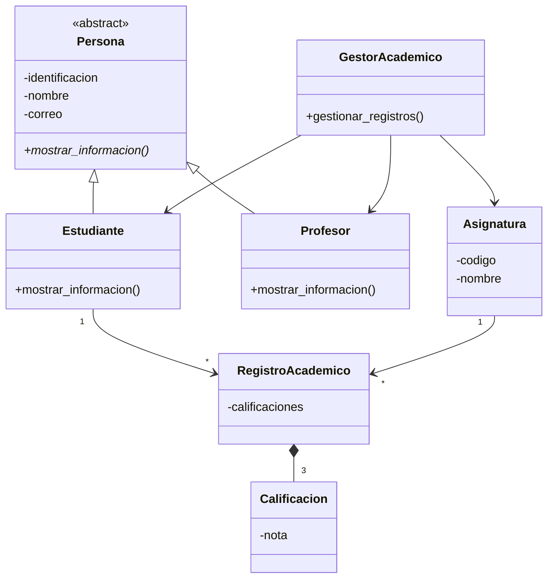

# EDUCONTROL

## Sistema de Gestión Académica

EDUCONTROL es una aplicación de escritorio desarrollada en Python que permite gestionar información académica de estudiantes, profesores, asignaturas y calificaciones mediante una interfaz gráfica intuitiva y organizada.

El proyecto fue desarrollado como parte del parcial integrador de la asignatura de Programación Orientada a Objetos, aplicando los principales fundamentos del paradigma POO.

> Búsqueda rápida antes de entregar: busca el texto `COMPLETAR` en este archivo. Cada coincidencia es algo que debes llenar con tus datos reales (capturas, nombres de archivos, pasos).

---

## 1. Descripción del proyecto

EDUCONTROL tiene como propósito facilitar la administración de información académica mediante un sistema que centraliza el registro y la consulta de estudiantes, profesores, asignaturas y resultados académicos.

La aplicación cuenta con un panel principal desde el cual se puede acceder a las diferentes funcionalidades del sistema, consultar información y visualizar estadísticas académicas.

El sistema utiliza almacenamiento en memoria, por lo que los datos se mantienen durante la ejecución de la aplicación, pero no se conservan después de cerrarla.

## 2. Problema que resuelve

La gestión manual de información académica puede generar desorganización, dificultades para consultar registros y errores al administrar calificaciones.

EDUCONTROL busca ofrecer una solución informática que permita organizar esta información de manera estructurada, facilitando su administración y consulta a través de una interfaz gráfica.

## 3. Objetivos

### Objetivo general

Desarrollar una aplicación de escritorio para la gestión académica, aplicando los principios de la Programación Orientada a Objetos y proporcionando una interfaz gráfica que facilite la administración de la información.

### Objetivos específicos

- Implementar clases y objetos para representar las entidades del sistema académico.
- Aplicar encapsulamiento, herencia, abstracción y polimorfismo.
- Establecer relaciones entre las diferentes clases del proyecto.
- Desarrollar una interfaz gráfica interactiva.
- Implementar funcionalidades para administrar estudiantes, profesores, asignaturas y calificaciones.
- Incorporar estadísticas para facilitar la interpretación de la información académica.

## 4. Funcionalidades principales

### 4.1. Panel principal

Presenta un resumen general del sistema mediante tarjetas informativas y elementos gráficos que permiten consultar rápidamente el estado de la información académica.

### 4.2. Gestión de estudiantes

Permite registrar, consultar y administrar la información de los estudiantes. COMPLETAR: indica qué operaciones concretas tiene el botón (agregar, buscar, editar, eliminar) y qué datos se piden.

### 4.3. Gestión de profesores

Permite organizar la información de los profesores registrados en el sistema. COMPLETAR: operaciones concretas.

### 4.4. Gestión de asignaturas

Permite administrar las asignaturas y organizar la información académica correspondiente. COMPLETAR: operaciones concretas.

### 4.5. Gestión de calificaciones

Permite registrar y actualizar las calificaciones de los estudiantes, aplicando las validaciones establecidas en el sistema. COMPLETAR: indica el rango válido de notas y qué mensaje aparece si el dato es incorrecto.

### 4.6. Estadísticas académicas

Presenta información gráfica y estadística relacionada con los registros académicos, facilitando su consulta y análisis.

## 5. Tecnologías utilizadas

| Tecnología | Descripción |
|---|---|
| Python | Lenguaje principal de programación. |
| CustomTkinter | Desarrollo de la interfaz gráfica. |
| Tkinter | Componentes y funcionalidades de la interfaz. |
| Matplotlib | Generación de gráficos y estadísticas. |
| Pillow | Procesamiento y manejo de imágenes. |
| Unittest | Ejecución de pruebas automatizadas. |
| Git y GitHub | Control de versiones y alojamiento del proyecto. |

### 5.1. Bibliotecas externas

| Biblioteca | Qué problema resuelve | Por qué se eligió | Instalación | Dónde se usa |
|---|---|---|---|---|
| CustomTkinter | Construir una interfaz de escritorio moderna. | Ofrece componentes más actuales que Tkinter y es compatible con él. | `pip install customtkinter` | Carpeta `interfaz/`: ventanas, formularios, botones y tablas. |
| Matplotlib | Mostrar estadísticas en gráficos. | Permite generar gráficos y integrarlos en la interfaz. | `pip install matplotlib` | Carpeta `interfaz/`: vista de estadísticas y panel principal. COMPLETAR: archivo exacto. |
| Pillow | Cargar y mostrar imágenes (íconos, logo). | CustomTkinter la requiere para manejar imágenes. | `pip install pillow` | Carpeta `interfaz/`: imágenes de la interfaz. COMPLETAR: archivo exacto. |

Las bibliotecas se integran con las clases del proyecto únicamente en la capa de interfaz; los modelos y servicios no dependen de ellas.

## 6. Arquitectura del sistema

El proyecto utiliza una estructura modular que separa los modelos de datos, la lógica de gestión académica y los componentes de la interfaz gráfica.

Esta organización permite mantener el código ordenado, facilitar su mantenimiento y distribuir las responsabilidades entre los diferentes módulos.

### Organización general

- **modelos:** contiene las clases que representan las entidades académicas.
- **servicios:** contiene la lógica encargada de gestionar las operaciones académicas.
- **interfaz:** contiene las ventanas, vistas, componentes visuales, gráficos y elementos de diseño.
- **pruebas:** contiene las pruebas automatizadas del sistema.
- **main.py:** punto de entrada para ejecutar la aplicación.

## 7. Aplicación de la Programación Orientada a Objetos

EDUCONTROL implementa los principales conceptos de la Programación Orientada a Objetos. El detalle completo, con archivos y fragmentos de código, está en [docs/INFORME_TECNICO.md](docs/INFORME_TECNICO.md).

### 7.1. Clases y objetos

Se utilizan clases para representar las entidades principales del sistema, como Persona, Estudiante, Profesor, Asignatura, Calificacion y RegistroAcademico.

A partir de estas clases se crean objetos que representan los registros administrados por la aplicación.

### 7.2. Encapsulamiento

Se protegen los atributos internos de las clases mediante atributos privados o protegidos y propiedades que permiten controlar el acceso a la información.

### 7.3. Herencia

Las clases Estudiante y Profesor heredan de la clase Persona, reutilizando sus atributos y comportamientos comunes.

### 7.4. Polimorfismo

Se implementa mediante el método `mostrar_informacion()`, definido de manera diferente en las clases Estudiante y Profesor, permitiendo que cada una proporcione su propia representación de la información.

### 7.5. Abstracción

La clase Persona se define como una clase abstracta que establece una estructura común para las clases que representan a las personas dentro del sistema.

### 7.6. Relaciones entre clases

El sistema establece relaciones entre sus entidades para representar la organización de la información académica, incluyendo relaciones de asociación, agregación y composición según las responsabilidades de cada clase.

## 8. Diagrama de clases

El siguiente diagrama representa la estructura general de las clases principales del sistema.



## 9. Interfaz gráfica

La interfaz gráfica fue desarrollada utilizando CustomTkinter, con una distribución organizada que facilita la navegación entre las diferentes secciones del sistema.

Entre sus elementos principales se encuentran:

- Panel de navegación lateral.
- Tarjetas informativas.
- Tablas para visualizar registros.
- Formularios para ingresar información.
- Botones para ejecutar operaciones.
- Gráficos estadísticos.
- Ventanas y componentes reutilizables.

La interfaz utiliza eventos y funciones de respuesta para conectar las acciones del usuario con la lógica del sistema.

## 10. Instalación

### Requisitos previos

- Python 3.10 o superior.
- Git.
- Conexión a internet para instalar las dependencias.

### Clonar el repositorio

```bash
git clone https://github.com/martin2508-cpu/EDUCONTROL.git
cd EDUCONTROL
```

### Instalar las dependencias

```bash
pip install -r requirements.txt
```

## 11. Ejecución

Desde la carpeta raíz del proyecto (donde está `main.py`):

```bash
python main.py
```

## 12. Manual de usuario

Cada sección explica cómo usar una funcionalidad. Guarda las capturas en `docs/imagenes/` con los nombres indicados.

### 12.1. Panel principal

Al abrir la aplicación se muestra el panel principal con tarjetas de resumen y gráficos. Desde el menú lateral se accede al resto de secciones.


### 12.2. Registrar un estudiante

1. En el menú lateral, seleccionar **Estudiantes**. COMPLETAR: nombre exacto del botón.
2. Llenar el formulario con los datos solicitados. COMPLETAR: lista de campos.
3. Presionar el botón de guardar. COMPLETAR: nombre exacto.
4. El estudiante aparece en la tabla.


### 12.3. Registrar una calificación

1. Seleccionar **Calificaciones**. COMPLETAR: nombre exacto.
2. Elegir el estudiante y la asignatura. COMPLETAR.
3. Ingresar la nota. Si el valor es inválido, el sistema muestra un mensaje de error. COMPLETAR: rango válido y mensaje.
4. Guardar y verificar el resultado en la tabla.


### 12.4. Consultar estadísticas

Seleccionar **Estadísticas** en el menú lateral para ver los gráficos del rendimiento académico. COMPLETAR: qué gráficos aparecen.


## 13. Estructura del proyecto

COMPLETAR: reemplaza los nombres de archivos por los reales de tu proyecto.

```
EDUCONTROL/
├── main.py                  # Punto de entrada de la aplicación
├── requirements.txt         # Dependencias externas
├── README.md                # Presentación y manual de usuario
├── modelos/                 # Entidades: Persona, Estudiante, Profesor, Asignatura, Calificacion, RegistroAcademico
├── servicios/               # Lógica de gestión académica (GestorAcademico)
├── interfaz/                # Ventanas, vistas, componentes y gráficos (CustomTkinter)
├── pruebas/                 # Pruebas automatizadas con unittest
└── docs/
    ├── INFORME_TECNICO.md   # Informe técnico del proyecto
    └── imagenes/            # Capturas de pantalla y diagramas
```

## 14. Pruebas del sistema

El proyecto incorpora pruebas automatizadas mediante la biblioteca `unittest`, con el propósito de verificar el comportamiento de los modelos, las operaciones académicas y determinados componentes gráficos.

Para ejecutar las pruebas, desde la raíz del proyecto:

```bash
python -m unittest discover -s pruebas -t . -v
```

En la versión verificada se ejecutaron 19 pruebas automatizadas, todas finalizadas correctamente. Las pruebas manuales documentadas están en el [informe técnico](docs/INFORME_TECNICO.md).

## 15. Almacenamiento de información

EDUCONTROL utiliza almacenamiento en memoria.

Esto significa que los registros creados durante la ejecución se mantienen disponibles mientras la aplicación permanece abierta. Sin embargo, al cerrar el programa, la información se pierde.

## 16. Limitaciones actuales

- No cuenta con una base de datos.
- La información no se conserva después de cerrar la aplicación.
- No dispone de autenticación de usuarios.
- No cuenta con conexión a un servidor externo.
- Su funcionamiento está orientado a un entorno de escritorio.

## 17. Mejoras futuras

- Implementación de una base de datos para almacenar la información permanentemente.
- Incorporación de módulos de autenticación y control de acceso.
- Generación de informes académicos.
- Exportación de información a formatos PDF y Excel.
- Implementación de nuevas herramientas de análisis estadístico.
- Optimización de la interfaz y ampliación de las funcionalidades.

## 18. Documentación adicional

El análisis del problema, el diseño del sistema, la arquitectura, la aplicación de los principios de POO, la construcción de la interfaz, las pruebas realizadas, los problemas encontrados y las conclusiones están en el [Informe técnico](docs/INFORME_TECNICO.md).

## 19. Autor

**Martin Castro**

Proyecto académico desarrollado para la asignatura de Programación Orientada a Objetos.

**Repositorio:** https://github.com/martin2508-cpu/EDUCONTROL

---

**EDUCONTROL — Sistema de Gestión Académica**
