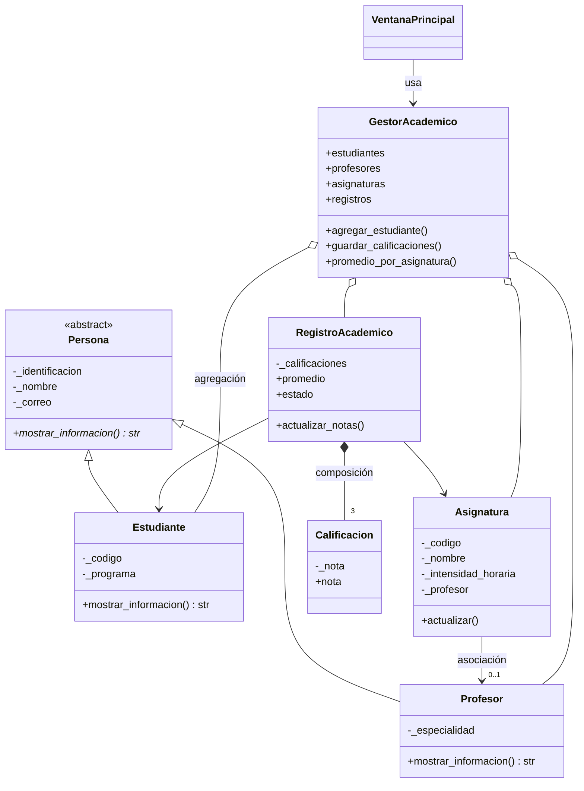

# INFORME TÉCNICO — EDUCONTROL

## 1. Análisis del problema

**Necesidad.** Administrar a mano estudiantes, docentes, materias y notas dificulta calcular promedios, detectar estudiantes en riesgo y comparar el rendimiento entre asignaturas.

**Público objetivo.** Personal académico o docentes que necesitan un control sencillo del rendimiento de un grupo de estudiantes.

**Funcionalidades.**
1. Gestión (crear, editar, buscar, eliminar) de estudiantes, profesores y asignaturas, con asignación de docente.
2. Registro de tres notas por estudiante y asignatura, con validación y cálculo automático de promedio y estado.
3. Dashboard y reportes: indicadores, gráficas interactivas, ranking, estudiantes en riesgo y resumen por asignatura.

**Limitaciones.** Los datos viven solo en memoria (no hay base de datos ni archivos, como permite el enunciado); al cerrar la aplicación se pierden. Un estudiante tiene exactamente tres notas por asignatura. No hay usuarios ni roles.

## 2. Diseño inicial

Se identificaron los sustantivos del problema para convertirlos en clases, y los verbos en métodos de un servicio que los coordina:

| Clase | Responsabilidad |
|---|---|
| `Persona` (abstracta) | Datos comunes (identificación, nombre, correo) con validación |
| `Estudiante`, `Profesor` | Especializan a `Persona` (código/programa; especialidad) |
| `Asignatura` | Materia con intensidad horaria y un profesor responsable |
| `Calificacion` | Una nota válida entre 0.0 y 5.0 |
| `RegistroAcademico` | Reúne las 3 notas de un estudiante en una asignatura; calcula promedio y estado |
| `GestorAcademico` | Guarda las colecciones, aplica las reglas (duplicados, existencia) y calcula estadísticas |
| `VentanaPrincipal` y vistas | Interfaz: muestran datos y reenvían las acciones del usuario al gestor |

Decisión de diseño: **la interfaz no contiene reglas del negocio**; solo llama al `GestorAcademico` y muestra el resultado o el error (`ValueError`).



## 3. Arquitectura

Tres capas con dependencia en un solo sentido (`interfaz → servicios → modelos`):

- **`modelos/`**: entidades del dominio. No conocen la interfaz.
- **`servicios/gestor_academico.py`**: casos de uso y estadísticas. No conoce la interfaz.
- **`interfaz/`**: ventana, vistas, componentes, gráficas, iconos y tema. Se divide en módulos pequeños (`vista_dashboard`, `vista_asignaturas`, `componentes`, `graficas`…) para que ningún archivo concentre todo. `graficas.py` no usa Tkinter, por lo que se prueba sin abrir ventanas.

`main.py` crea `VentanaPrincipal`, que crea el `GestorAcademico` y carga los datos de demostración. Flujo típico: el usuario pulsa un botón → *callback* en la vista → llamada al gestor → el gestor valida y modifica los modelos (o lanza `ValueError`) → la vista actualiza la tabla o muestra el aviso.

## 4. Aplicación de POO

| Concepto | Clase o método | Archivo | Explicación |
|---|---|---|---|
| Clases y objetos | `Estudiante`, `Profesor`, `Asignatura`, `Calificacion`, `RegistroAcademico`, `GestorAcademico` | `modelos/*.py`, `servicios/gestor_academico.py` | Cada una con una responsabilidad única; el gestor crea y mantiene los objetos en listas |
| Encapsulamiento | `Persona._nombre` y propiedades de solo lectura; `Calificacion.nota` (setter con validación 0–5); `Asignatura.intensidad_horaria`/`nombre` (setters validados) y `Asignatura.actualizar()`; `Estudiante.codigo`, `Profesor.especialidad`; `RegistroAcademico.calificaciones` (devuelve tupla) | `modelos/*.py` | El estado solo cambia por vías que validan; `actualizar()` valida todo antes de asignar, así un error no deja la asignatura a medias |
| Herencia | `Estudiante(Persona)`, `Profesor(Persona)` | `modelos/estudiante.py`, `modelos/profesor.py` | Reutilizan identificación, nombre y correo y llaman a `super().__init__()`; añaden sus propios datos |
| Polimorfismo | `mostrar_informacion()` | `modelos/estudiante.py`, `modelos/profesor.py`; usado en `VentanaPrincipal._confirmar_eliminacion` | Esa función recibe una `Persona` cualquiera y llama al mismo método; cada subclase responde con un texto distinto en el cuadro de confirmación de eliminación |
| Abstracción | `Persona(ABC)` con `@abstractmethod mostrar_informacion` | `modelos/persona.py` | Contrato: toda persona del sistema debe poder describirse; `Persona` no se puede instanciar |
| Asociación | `Asignatura.profesor`; `RegistroAcademico.estudiante/asignatura` | `modelos/asignatura.py`, `modelos/registro_academico.py` | Los objetos se conocen pero existen por separado (al borrar un profesor, la asignatura queda sin docente) |
| Agregación | `GestorAcademico.estudiantes/profesores/asignaturas/registros` | `servicios/gestor_academico.py` | El gestor agrupa y administra objetos que tienen sentido por sí mismos |
| Composición | `RegistroAcademico._calificaciones` | `modelos/registro_academico.py` | El registro crea sus 3 `Calificacion`; sin registro no existen |

Fragmentos clave:

```python
# Abstracción + herencia (modelos/persona.py, modelos/estudiante.py)
class Persona(ABC):
    @abstractmethod
    def mostrar_informacion(self): ...

class Estudiante(Persona):
    def __init__(self, identificacion, nombre, correo, codigo, programa):
        super().__init__(identificacion, nombre, correo)
```

```python
# Encapsulamiento con validación (modelos/calificacion.py)
@nota.setter
def nota(self, valor):
    numero = float(valor)
    if not 0 <= numero <= 5:
        raise ValueError("La nota debe estar entre 0.0 y 5.0.")
    self._nota = round(numero, 2)
```

```python
# Polimorfismo (interfaz/ventana_principal.py)
def _confirmar_eliminacion(self, persona, aviso=""):
    return messagebox.askyesno("Confirmar eliminación",
        f"¿Eliminar este registro?\n\n{persona.mostrar_informacion()}...")
```

## 5. Construcción de la interfaz

- **Biblioteca:** CustomTkinter (tema oscuro) para ventanas, botones y tarjetas; `ttk.Treeview` para tablas; Matplotlib embebido con `FigureCanvasTkAgg` para las gráficas; Pillow para los iconos.
- **Diseño:** barra lateral de navegación + área de contenido. Panel general con 4 indicadores y 6 gráficas, y vistas de administración con buscador, tabla y botones de acción.
- **Controles:** botones, cuadros de texto, listas desplegables (estudiante, asignatura, docente), tablas con selección, buscador, formularios en ventana modal y avisos flotantes.
- **Eventos y callbacks:** `command=` en botones; `bind("<KeyRelease>")` en el buscador; `bind("<Double-1>")` para editar; eventos de ratón de Matplotlib (`motion_notify_event`, `button_press_event`) para tooltips, resaltado y clic en barras; `after()` para la animación de entrada de las barras y para cerrar los avisos.
- **Comunicación con las clases:** cada callback llama al `GestorAcademico`. Los errores de validación (`ValueError`) se muestran al usuario y el formulario se reabre conservando lo escrito.

Capturas: ver `docs/imagenes/` (también incluidas en el README).


## 6. Proceso de desarrollo

1. **Formulación de la idea:** un sistema de gestión académica sencillo pero completo, con tema libre y sin persistencia.
2. **Identificación de funcionalidades:** CRUD de entidades, registro de notas con promedio y reportes/dashboard.
3. **Diseño de clases:** del análisis de sustantivos salieron las clases de la sección 2; se decidió qué relaciones eran reales (herencia de `Persona`, composición de notas) en lugar de forzar las demás.
4. **Construcción de la lógica:** primero `modelos/` y `GestorAcademico`, probados con `unittest` antes de existir la interfaz.
5. **Desarrollo de la interfaz:** ventana y navegación, vistas CRUD y luego dashboard con gráficas.
6. **Integración:** conexión de los callbacks con el gestor y manejo de errores de validación.
7. **Pruebas y correcciones:** pruebas unitarias, revisión visual de cada vista y ajustes (ver sección 8).

## 7. Pruebas

Se ejecutan con `python -m unittest discover -s pruebas -t . -v`. Resultado: **23 pruebas, todas OK**. Las más representativas:

| Prueba | Acción realizada | Resultado esperado | Resultado obtenido |
|---|---|---|---|
| 1. Promedio y estado | `guardar_calificaciones("1001", "MAT01", [4, 3, 5])` | Promedio 4.0 y estado "Aprobado" | Promedio 4.0, "Aprobado" ✔ (`test_promedio`) |
| 2. Reprobado | Notas `[2, 2.5, 3]` | Estado "Reprobado" (promedio 2.5 < 3.0) | "Reprobado" ✔ (`test_reprobado`) |
| 3. **Error:** nota fuera de rango | Guardar notas `[4, 6, 5]` | Se rechaza con `ValueError` y no se guarda | `ValueError` lanzado ✔ (`test_nota_fuera_de_rango`) |
| 4. **Error:** identificación repetida | Registrar dos estudiantes con la identificación "1001" | `ValueError` ("Ya existe un estudiante…") | `ValueError` lanzado ✔ (`test_identificacion_duplicada`) |
| 5. Abstracción | Instanciar `Persona(...)` directamente | `TypeError` (clase abstracta) | `TypeError` ✔ (`test_persona_es_abstracta`) |
| 6. Polimorfismo | Llamar `mostrar_informacion()` en un `Estudiante` y un `Profesor` | Textos distintos ("Estudiante: …" / "Profesor: …") | Textos distintos ✔ (`test_polimorfismo_mostrar_informacion`) |
| 7. Encapsulamiento | Asignar `estudiante.codigo = "otro"`; poner horas = 0 en una asignatura | `AttributeError`; `ValueError` sin alterar el objeto | Ambos ✔ (`test_atributos_protegidos`, `test_asignatura_valida_al_modificar`) |

Además hay pruebas de las estadísticas del gestor (por asignatura, distribución, riesgo, ranking) y de las gráficas, que se dibujan sin abrir ventanas y responden a eventos de ratón simulados. La interfaz se revisó visualmente vista por vista (capturas en `docs/imagenes/`).

## 8. Problemas y soluciones

**Problema 1 — Esquinas con "cuadritos" oscuros en Windows.**
*Diagnóstico:* en una captura en Windows aparecían pequeños cuadros oscuros en las esquinas de tarjetas, botones del menú y logo. CustomTkinter dibuja cada esquina redondeada en un lienzo cuyo color de fondo toma del widget padre; los *frames* transparentes usaban además un radio por defecto (6 px) que no se veía pero generaba esas esquinas. *Solución:* primero se puso un `bg_color` explícito en todos los widgets redondeados y radio 0 en los frames transparentes; como en esa pantalla seguían apareciendo, se centralizó el redondeo en `tema.REDONDEO` (valor 0 = esquinas rectas) y se hicieron opacos los iconos con esquinas. Con eso ya no se dibuja ninguna esquina redondeada.

**Problema 2 — Iconos de texto desiguales.**
*Diagnóstico:* los iconos del menú eran símbolos Unicode (♙ ♧ ▤ ✎ ▥); según la fuente instalada salían pequeños, de tamaños distintos y desalineados. *Solución:* se creó `interfaz/iconos.py`, que dibuja cada icono con Pillow (a 8x y reducido) y lo entrega como `CTkImage`; ahora todos tienen el mismo tamaño y no dependen de la fuente del equipo.

**Problema 3 — Polimorfismo que existía pero no se usaba.**
*Diagnóstico:* al revisar el proyecto contra el enunciado, `mostrar_informacion()` estaba definido en `Estudiante` y `Profesor` pero ningún código lo llamaba, es decir, el polimorfismo era solo decorativo. *Solución:* se agregó `VentanaPrincipal._confirmar_eliminacion(persona)`, que muestra en el cuadro de confirmación el texto de `mostrar_informacion()` de cualquier `Persona`, y se añadió una prueba que lo verifica.

## 9. Conclusiones

El proyecto permitió aplicar abstracción, herencia, polimorfismo, encapsulamiento y los tres tipos de relación entre objetos con un propósito real dentro de la aplicación, manteniendo la lógica separada de la interfaz y comprobándola con pruebas automáticas. Las mayores dificultades estuvieron en la interfaz (renderizado de esquinas, iconos y gráficas interactivas), no en la lógica. Como mejoras posibles: guardar los datos en un archivo o base de datos, permitir un número variable de notas con porcentajes por corte, exportar reportes a PDF o Excel, y agregar roles de usuario.
