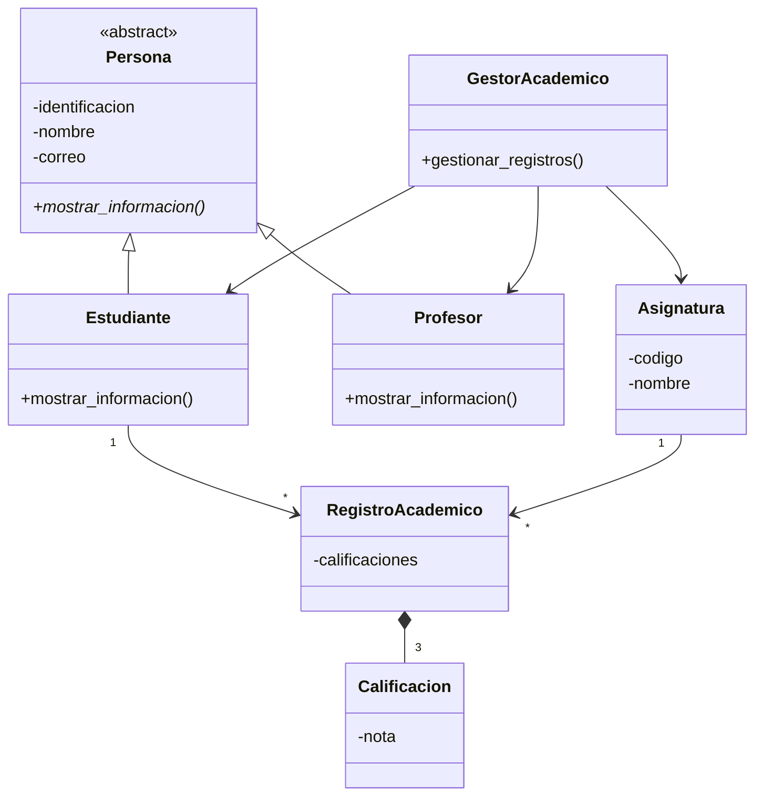

# Informe Técnico — EDUCONTROL

**Sistema de Gestión Académica**
**Autor:** Martin Castro
**Asignatura:** Programación Orientada a Objetos con Python
---

## 1. Análisis del problema

### Necesidad identificada

La gestión manual de información académica (estudiantes, profesores, asignaturas y notas) genera desorganización, dificultad para consultar registros y errores al administrar calificaciones.

### Público objetivo

Personal administrativo o docente de una institución educativa que necesita registrar y consultar información académica de forma rápida y ordenada.

### Funcionalidades

- Panel principal con resumen mediante tarjetas informativas.
- Gestión de estudiantes.
- Gestión de profesores.
- Gestión de asignaturas.
- Gestión de calificaciones con validaciones.
- Estadísticas académicas con gráficos.

### Limitaciones

- Almacenamiento en memoria: los datos se pierden al cerrar la aplicación.
- Sin base de datos, sin autenticación de usuarios y sin conexión a un servidor.
- Orientada únicamente a un entorno de escritorio.

## 2. Diseño inicial

Antes de programar se identificaron las entidades del dominio académico y se asignó una responsabilidad a cada clase:

| Clase | Responsabilidad |
|---|---|
| Persona | Clase abstracta con los datos comunes (identificación, nombre, correo). |
| Estudiante | Representa a un estudiante; especializa `mostrar_informacion()`. |
| Profesor | Representa a un profesor; especializa `mostrar_informacion()`. |
| Asignatura | Representa una materia (código y nombre). |
| Calificacion | Representa una nota con su validación. |
| RegistroAcademico | Relaciona a un estudiante con una asignatura y agrupa sus calificaciones. |
| GestorAcademico | Coordina las operaciones sobre estudiantes, profesores y asignaturas. |

### Diagrama de clases



## 3. Arquitectura

El código se organiza en capas para separar responsabilidades:

| Componente | Carpeta | Función |
|---|---|---|
| Modelos | `modelos/` | Entidades del dominio y sus reglas (validaciones, encapsulamiento). |
| Servicios | `servicios/` | Lógica de gestión académica; opera sobre los modelos. |
| Interfaz | `interfaz/` | Ventanas, vistas, formularios, tablas y gráficos con CustomTkinter. |
| Pruebas | `pruebas/` | Pruebas automatizadas con `unittest`. |
| Punto de entrada | `main.py` | Crea la aplicación y la ejecuta. |

### Comunicación entre componentes

```
Usuario → Interfaz → Servicios → Modelos
                ↑                    │
                └──── resultados ────┘
```

La interfaz recibe las acciones del usuario y llama a los servicios. Los servicios crean y modifican objetos de los modelos y devuelven el resultado a la interfaz para mostrarlo. La interfaz no contiene la lógica del sistema; los modelos y servicios no dependen de CustomTkinter, Matplotlib ni Pillow.

## 4. Aplicación de POO

| Concepto | Clase o método | Archivo | Explicación |
|---|---|---|---|
| Clases y objetos | `Persona`, `Estudiante`, `Profesor`, `Asignatura`, `Calificacion`, `RegistroAcademico`, `GestorAcademico` | `modelos/` y `servicios/` | Cada clase representa una entidad del dominio con su propia responsabilidad. Los objetos son los registros que maneja la aplicación. |
| Encapsulamiento | Atributos privados o protegidos y propiedades (`@property`) en `Persona` y `Calificacion` | `modelos/` | Controlan el acceso a los datos y validan los valores, por ejemplo que la nota esté dentro del rango permitido. |
| Herencia | `Estudiante` y `Profesor` heredan de `Persona` | `modelos/` | Reutilizan identificación, nombre y correo, y agregan sus datos propios. |
| Polimorfismo | `mostrar_informacion()` | `modelos/` | Estudiante y Profesor responden al mismo método con una representación distinta. |
| Abstracción | `Persona` como clase abstracta | `modelos/` | Define el contrato común (`mostrar_informacion()` abstracto) que deben cumplir las clases que representan personas. |
| Relaciones | `Estudiante`, `Asignatura`, `RegistroAcademico`, `Calificacion`, `GestorAcademico` | `modelos/` y `servicios/` | Asociación entre estudiante, asignatura y registro; composición entre registro y calificaciones; el gestor coordina las entidades. |

## 5. Construcción de la interfaz

### Biblioteca seleccionada

**CustomTkinter**, sobre Tkinter. Se eligió por ofrecer componentes de aspecto moderno y ser compatible con Tkinter. Para los gráficos se usó **Matplotlib** y para las imágenes **Pillow**.

### Diseño de la interfaz

Distribución con un panel de navegación lateral y un área central donde se muestra cada sección.

### Controles implementados

- Panel de navegación lateral.
- Tarjetas informativas.
- Tablas para visualizar registros.
- Formularios de ingreso de datos.
- Botones de acción.
- Gráficos estadísticos.

### Eventos y callbacks

Cada botón está asociado a una función de respuesta que se ejecuta cuando el usuario interactúa con él. Esa función toma los datos del formulario y los envía a la lógica del sistema.

### Comunicación con las clases

La interfaz llama a los métodos del gestor académico y muestra el resultado o el mensaje de error. Las validaciones de los datos viven en los modelos, no en la interfaz.

### Capturas de pantalla


## 6. Proceso de desarrollo

1. **Formulación de la idea:** se decidió crear un sistema de gestión académica por ser un dominio con entidades claras que permite aplicar herencia, polimorfismo, abstracción y relaciones.
2. **Identificación de funcionalidades:** estudiantes, profesores, asignaturas, calificaciones y estadísticas.
3. **Diseño de clases:** se definieron las entidades y sus relaciones (ver diagrama de clases).
4. **Construcción de la lógica:** implementación de modelos y servicios.
5. **Desarrollo de la interfaz:** construcción de las vistas con CustomTkinter.
6. **Integración:** conexión de la interfaz con los servicios.
7. **Pruebas y correcciones:** pruebas automatizadas con `unittest` y pruebas manuales desde la interfaz.

## 7. Pruebas

### Pruebas automatizadas

Se ejecutan con:

```bash
python -m unittest discover -s pruebas -t . -v
```

En la versión verificada se ejecutaron 19 pruebas, todas correctas.

### Pruebas manuales

| Prueba | Acción realizada | Resultado esperado | Resultado obtenido |
|---|---|---|---|
| Prueba 1: registrar un estudiante | Abrir la sección de estudiantes, llenar el formulario con datos válidos y guardar. | El estudiante aparece en la tabla. | El estudiante se registró y apareció en la tabla. |
| Prueba 2: registrar una nota válida | Elegir un estudiante y una asignatura, ingresar una nota dentro del rango y guardar. | La nota se guarda y se refleja en la tabla y en las estadísticas. | La nota se guardó y se reflejó en la tabla y en las estadísticas. |
| Prueba 3 (caso de error): nota inválida | Ingresar una nota fuera del rango permitido, por ejemplo un valor negativo o mayor al máximo. | El sistema rechaza el dato y muestra un mensaje de error sin guardar nada. | El sistema rechazó el valor y mostró el mensaje de error; no se guardó ningún dato. |

## 8. Problemas y soluciones

### Problema 1: importaciones fallidas al ejecutar las pruebas

- **Síntoma:** al ejecutar las pruebas desde la carpeta `pruebas/`, Python no encontraba los módulos `modelos` y `servicios`.
- **Diagnóstico:** el directorio desde el que se ejecutaba no estaba en la ruta de búsqueda de módulos, por lo que las importaciones entre paquetes fallaban.
- **Solución:** ejecutar las pruebas siempre desde la raíz del proyecto, indicando el directorio de pruebas y el directorio base con `python -m unittest discover -s pruebas -t . -v`.

### Problema 2: lógica mezclada con la interfaz

- **Síntoma:** en las primeras versiones, las validaciones de las notas estaban dentro de las funciones de los botones, lo que las hacía difíciles de probar.
- **Diagnóstico:** la interfaz concentraba responsabilidades que correspondían a los modelos y servicios.
- **Solución:** se movieron las validaciones a las clases del modelo y a los servicios, dejando a la interfaz solo la tarea de recibir los datos y mostrar los resultados. Así fue posible cubrirlas con pruebas automatizadas.

## 9. Conclusiones

El proyecto permitió integrar los conceptos de POO vistos en el semestre en una aplicación funcional: clases con responsabilidades definidas, encapsulamiento de los datos, herencia desde una clase abstracta, polimorfismo en `mostrar_informacion()` y relaciones entre entidades. La separación en modelos, servicios e interfaz facilitó probar la lógica sin depender de la ventana.

### Dificultades

Las principales dificultades fueron organizar el código en capas, mantener las validaciones fuera de la interfaz y asegurar que las pruebas se ejecutaran correctamente desde la raíz del proyecto.

### Posibles mejoras

- Base de datos para conservar la información entre sesiones.
- Autenticación y control de acceso.
- Generación de informes y exportación a PDF y Excel.
- Nuevas herramientas de análisis estadístico.
